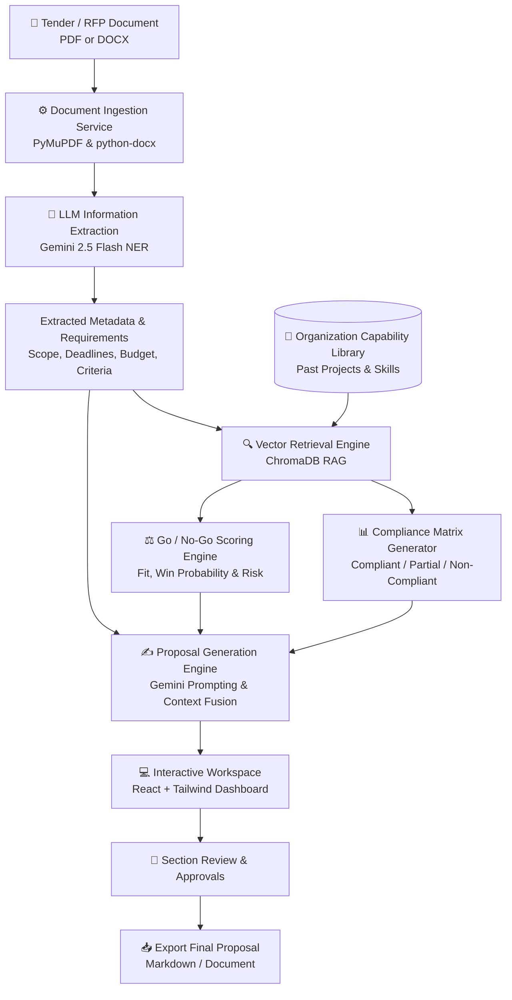

# 🚀 LetsBid

> **AI-Powered RFP & Tender Intelligence Platform**  
> *Streamline document ingestion, requirement extraction, capability matching, Go/No-Go decision scoring, and automated proposal drafting.*

---

## 📖 Overview

**LetsBid** is an end-to-end, AI-powered platform engineered to modernize the Request for Proposal (RFP) and tender response lifecycle. Traditional bidding processes take days or weeks of manual effort reviewing dense tender documents, mapping technical capabilities, calculating compliance, and writing repetitive proposal sections.

**LetsBid automates this entire pipeline:**
1. **Parses** complex RFP documents (PDF & DOCX).
2. **Extracts** structured entities, mandatory requirements, evaluation criteria, budgets, and deadlines using Google Gemini.
3. **Matches** requirements against your organization's capability catalog using ChromaDB vector search (RAG).
4. **Builds** an automated, auditable **Compliance Matrix** with confidence scoring.
5. **Computes** a data-driven **Go / No-Go Decision Score** (win probability, technical alignment, and risk factors).
6. **Generates** complete, tailored proposal drafts with section-by-section editing, approval workflows, and export capabilities.

---

## 🏗️ Architecture & Pipeline Flow



---

## ✨ Key Features

- **📑 Smart Document Ingestion**: Upload multi-page tender briefs in `.pdf` or `.docx` format with automatic text extraction, cleansing, and chunking.
- **🏷️ Structured NER Extraction**: Automatically identifies client information, submission deadlines, estimated budgets, mandatory technical criteria, and evaluation guidelines.
- **🔎 RAG-Powered Capability Alignment**: Semantically queries past project credentials and organizational capability libraries to establish evidence-backed compliance.
- **📋 Automated Compliance Matrix**: Calculates similarity thresholds to tag requirements as:
  - 🟢 **Fully Compliant**
  - 🟡 **Partially Compliant**
  - 🔴 **Non-Compliant**
- **🎯 Objective Go / No-Go Scoring**: Evaluates deal viability through weighted scoring algorithms measuring technical fit, timeline feasibility, and project risk profile.
- **✍️ Modular Proposal Drafting**: Automatically drafts:
  - Executive Summary
  - Technical Approach & Solution Architecture
  - Capability & Past Performance Alignment
  - Compliance Matrix & Quality Assurance
  - Commercial & Pricing Structure
- **🛠️ Section Editor & Review Workflow**: Review, modify, and officially approve individual proposal sections before exporting.
- **🎨 Modern Web Interface**: Clean, responsive, and accessible UI crafted with React 18, Tailwind CSS, and Vite.

---

## 🛠️ Tech Stack

### Backend
- **Framework**: [FastAPI](https://fastapi.tiangolo.com/) (Python 3.11+)
- **Server**: [Uvicorn](https://www.uvicorn.org/) (ASGI)
- **AI & LLM**: [Google Generative AI](https://ai.google.dev/) (`gemini-2.5-flash`)
- **Vector Database**: [ChromaDB](https://www.trychroma.com/) (Embedded vector store for RAG)
- **Database & ORM**: SQLite & SQLAlchemy 2.0
- **Document Parsing**: [PyMuPDF (fitz)](https://pymupdf.readthedocs.io/) & [python-docx](https://python-docx.readthedocs.io/)
- **Data Validation**: Pydantic v2 & Pydantic-Settings

### Frontend
- **Framework**: [React 18](https://react.dev/) + [TypeScript](https://www.typescriptlang.org/)
- **Build Tool**: [Vite](https://vitejs.dev/)
- **Styling**: [Tailwind CSS](https://tailwindcss.com/) + PostCSS
- **Routing**: [React Router v6](https://reactrouter.com/)
- **HTTP Client**: Fetch API with typed service wrappers

---

## 📁 Repository Structure

```text
letsbid/
├── backend/
│   ├── app/
│   │   ├── api/
│   │   │   └── v1/
│   │   │       ├── endpoints/
│   │   │       │   ├── analyze.py       # Full pipeline end-to-end endpoint
│   │   │       │   ├── compliance.py    # Compliance matrix endpoints
│   │   │       │   ├── documents.py     # Document ingestion and parsing
│   │   │       │   ├── go_nogo.py       # Go/No-Go bid scoring
│   │   │       │   ├── health.py        # System health checks
│   │   │       │   ├── ner.py           # Entity & requirement extraction
│   │   │       │   ├── proposals.py     # Proposal generation, editing & export
│   │   │       │   └── rag.py           # Vector indexing & capability matching
│   │   │       └── router.py            # API v1 central router
│   │   ├── core/
│   │   │   └── config.py                # Pydantic environment configuration
│   │   ├── db/
│   │   │   ├── chroma.py                # ChromaDB vector store client
│   │   │   └── sqlite.py                # SQLite database session and setup
│   │   ├── models/                      # SQLAlchemy database models
│   │   ├── schemas/                     # Pydantic request/response schemas
│   │   ├── services/                    # Business logic & AI pipelines
│   │   │   ├── analyze_pipeline.py      # Orchestrator for full analysis flow
│   │   │   ├── capability_loader.py     # Capability catalog CSV loader
│   │   │   ├── compliance_matrix.py     # Compliance rules and scoring
│   │   │   ├── document_ingestion.py    # PDF and DOCX parsers
│   │   │   ├── gemini_client.py         # Google Gemini API client
│   │   │   ├── go_nogo_scoring.py       # Scoring algorithms
│   │   │   ├── ner_extraction.py        # LLM prompt schemas for extraction
│   │   │   ├── proposal_generation.py   # Draft generation and state store
│   │   │   └── rag_service.py           # Semantic matching logic
│   │   └── main.py                      # FastAPI application entrypoint
│   ├── data/
│   │   ├── capability_library.csv       # Organizational past performance catalog
│   │   └── historical_bids.csv          # Historic bid outcomes & training data
│   ├── requirements.txt                 # Backend Python dependencies
│   └── .env.example                     # Backend environment template
│
├── frontend/
│   ├── src/
│   │   ├── api/
│   │   │   └── client.ts                # Typed API client for FastAPI
│   │   ├── components/
│   │   │   ├── ComplianceMatrix.tsx     # Matrix table with status pills
│   │   │   ├── EntityResults.tsx        # Extracted requirements viewer
│   │   │   ├── GoNoGoScore.tsx          # Gauge/score presentation
│   │   │   ├── Layout.tsx               # Navigation bar & layout shell
│   │   │   ├── ProposalDraft.tsx        # Proposal section review component
│   │   │   └── RequireProject.tsx       # Route guard requiring active project
│   │   ├── context/
│   │   │   └── ProjectContext.tsx       # Active project & analysis state store
│   │   ├── pages/
│   │   │   ├── Dashboard.tsx            # Project list & stats dashboard
│   │   │   ├── ProjectCreation.tsx      # RFP upload & pipeline trigger
│   │   │   ├── Workspace.tsx            # Central project overview
│   │   │   ├── ExtractedRequirements.tsx# Requirements inspector
│   │   │   ├── ComplianceMatrixPage.tsx # Compliance breakdown page
│   │   │   ├── ScoringDashboard.tsx     # Go / No-Go decision analytics
│   │   │   ├── ProposalEditor.tsx       # Draft editor and approvals
│   │   │   └── ExportScreen.tsx         # Final export & review
│   │   ├── App.tsx                      # Routing & navigation configuration
│   │   └── main.tsx                     # React DOM initialization
│   ├── package.json                     # Frontend dependencies & scripts
│   ├── vite.config.ts                   # Vite configuration with API proxy
│   └── tailwind.config.js               # Tailwind design system configuration
│
├── .gitignore
└── README.md
```

---

## ⚡ Quick Start Guide

### Prerequisites
- **Python 3.11+**
- **Node.js 18+** and **npm**
- **Google Gemini API Key** (Get one from [Google AI Studio](https://aistudio.google.com/))

---

### 1. Backend Setup

1. **Navigate to the backend directory**:
   ```bash
   cd backend
   ```

2. **Create and activate a virtual environment**:
   - **Windows (PowerShell)**:
     ```powershell
     python -m venv .venv
     .\.venv\Scripts\Activate.ps1
     ```
   - **Linux / macOS**:
     ```bash
     python3 -m venv .venv
     source .venv/bin/activate
     ```

3. **Install dependencies**:
   ```bash
   pip install -r requirements.txt
   ```

4. **Configure environment variables**:
   Copy `.env.example` to `.env`:
   ```bash
   cp .env.example .env
   ```
   Open `.env` and insert your Gemini API Key:
   ```env
   APP_NAME=LetsBid
   APP_ENV=development
   API_V1_PREFIX=/api/v1
   CORS_ORIGINS=http://localhost:5173
   SQLITE_DATABASE_URL=sqlite:///./data/letsbid.db
   CHROMA_PERSIST_DIR=./data/chroma
   GEMINI_API_KEY=your_actual_gemini_api_key_here
   GEMINI_MODEL=gemini-2.5-flash
   NER_MAX_INPUT_CHARS=120000
   ```

5. **Start the FastAPI server**:
   ```bash
   uvicorn app.main:app --reload --port 8000
   ```
   The API will be live at `http://localhost:8000`.  
   Interactive Swagger docs are available at `http://localhost:8000/docs`.

---

### 2. Frontend Setup

1. **Navigate to the frontend directory**:
   ```bash
   cd ../frontend
   ```

2. **Install dependencies**:
   ```bash
   npm install
   ```

3. **Start the Vite development server**:
   ```bash
   npm run dev
   ```
   Open your browser at `http://localhost:5173`.  
   *(Vite is preconfigured to automatically proxy `/api` requests to `http://localhost:8000`)*.

---

## 🔌 API Endpoints Reference

The backend provides a comprehensive RESTful API under `/api/v1`:

| Method | Endpoint | Description |
| :--- | :--- | :--- |
| `GET` | `/api/v1/health` | Health check endpoint verifying service status. |
| `POST` | `/api/v1/documents/ingest` | Uploads and extracts plain text from a `.pdf` or `.docx` file. |
| `POST` | `/api/v1/analyze/document` | **Full Pipeline**: Runs document ingestion, NER, RAG matching, compliance, scoring, and proposal drafting in a single call. |
| `POST` | `/api/v1/ner/extract` | Extracts entities and requirements from raw text input. |
| `POST` | `/api/v1/ner/extract-document` | Uploads a document and returns extracted entities. |
| `POST` | `/api/v1/rag/index` | Indexes or refreshes the capability library CSV into ChromaDB. |
| `POST` | `/api/v1/rag/match` | Queries ChromaDB for capabilities matching a list of requirements. |
| `POST` | `/api/v1/compliance/matrix` | Generates a compliance matrix given matched requirements and thresholds. |
| `POST` | `/api/v1/go-nogo/score` | Calculates Go/No-Go probability, technical fit score, and risk breakdown. |
| `POST` | `/api/v1/proposals/generate` | Generates a draft proposal tailored to the RFP. |
| `GET` | `/api/v1/proposals/{id}` | Fetches an existing proposal and its sections. |
| `PUT` | `/api/v1/proposals/{id}/sections/{section_id}` | Updates content for a specific proposal section. |
| `POST` | `/api/v1/proposals/{id}/sections/{section_id}/approve` | Marks a proposal section as approved. |
| `GET` | `/api/v1/proposals/{id}/export` | Exports the full aggregated proposal in Markdown/structured format. |

---

## 📊 Environment Configuration Details

| Variable | Default Value | Description |
| :--- | :--- | :--- |
| `APP_NAME` | `LetsBid` | Display name of the application. |
| `APP_ENV` | `development` | Deployment environment (`development`, `production`). |
| `API_V1_PREFIX` | `/api/v1` | URL prefix for all API routes. |
| `CORS_ORIGINS` | `http://localhost:5173` | Allowed CORS origins (comma-separated). |
| `SQLITE_DATABASE_URL` | `sqlite:///./data/letsbid.db` | Path to SQLite database file. |
| `CHROMA_PERSIST_DIR` | `./data/chroma` | Directory where ChromaDB vector embeddings persist. |
| `GEMINI_API_KEY` | *(Required)* | Google Gemini API key. |
| `GEMINI_MODEL` | `gemini-2.5-flash` | Gemini model variant used for NER and generation. |
| `NER_MAX_INPUT_CHARS` | `120000` | Character limit for prompt inputs to prevent context overflows. |

---

## 🤝 Contributing

Contributions, issues, and feature requests are welcome!
1. Fork the repository.
2. Create your feature branch (`git checkout -b feature/amazing-feature`).
3. Commit your changes (`git commit -m 'feat: add amazing feature'`).
4. Push to the branch (`git push origin feature/amazing-feature`).
5. Open a Pull Request.

---

## 📄 License

This project is licensed under the MIT License.

